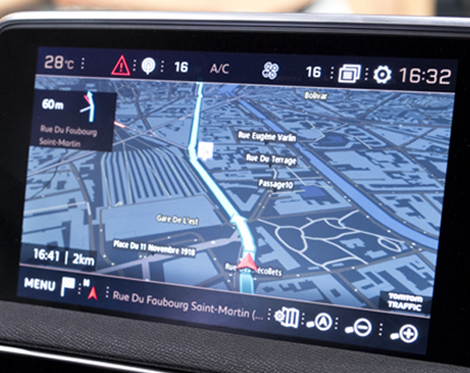
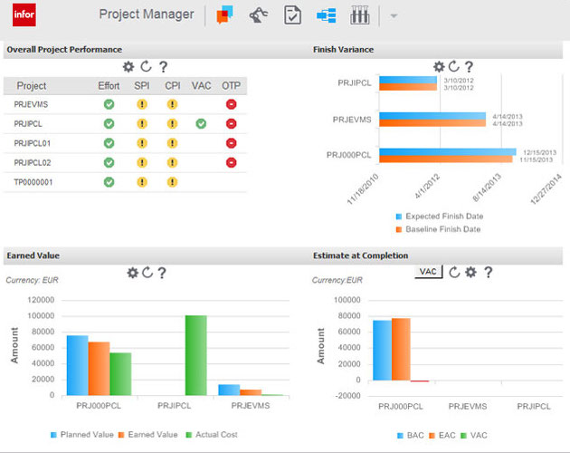
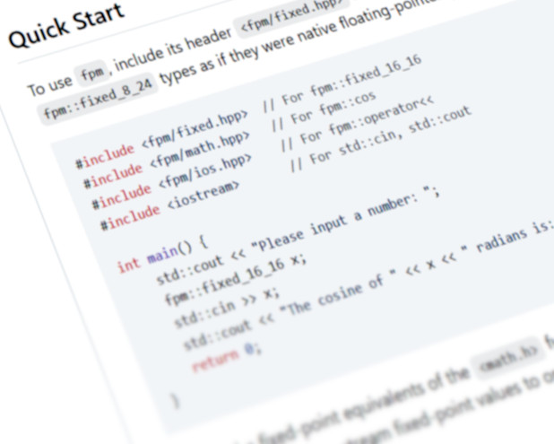
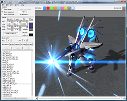
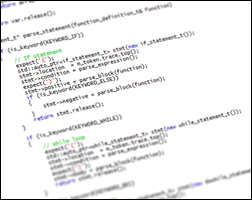
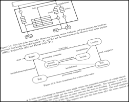
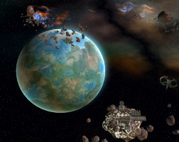
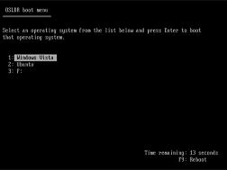

# Portfolio

Below are some projects that I was part of (that I can mention), professionally or otherwise, or projects that I created.

## TomTom Navigation SDK

[Navigation SDK](https://www.tomtom.com/products/navigation-sdk-for-mobile/) is [TomTom](https://www.tomtom.com)'s software development kit that lets developers build navigation directly into their own apps or vehicle systems, using TomTom’s mapping, routing, traffic, and navigation technology. It is a multi-million LoC project with dozens of teams and hundreds of developers and uses predominantly C++, Kotlin, Swift, Conan, CMake and Maven. I also contributed to its predecessors: [NavKit](https://download.tomtom.com/open/banners/1432805466-product-sheet-tomtom-navkit-4.pdf) and [NavKit 2](https://download.tomtom.com/open/banners/NavKit2-product-sheet.pdf).

I contributed to these projects professionally as Tech Lead and later as Staff Software Engineer, in various teams which were responsible for, among other, the shared [NDS](https://nds-association.org/) and [NDS.Live](https://nds-association.org/#live) map data access layer and applying [NDS map updates](https://docs.tomtom.com/nds-map-updates/documentation/product-information/introduction).

## Infor LN UI

Infor LN UI is the web-based UI for [Infor](https://www.infor.com/)'s ERP product,
[Infor LN](https://www.infor.com/product-summary/erp/ln/), the successor to [Baan ERP](https://en.wikipedia.org/wiki/Baan_Corporation).
The UI was a replacement for an applet-based UI and interacted with a UI-independent back-end and targeted all major browsers at the time.
The UI consisted of both of a library of reusable company-style-consistent widgets and an integration layer with the backend.

I was a Software Engineer in the UI team, where I prototyped the UI from the ground up and implemented new widgets and functionality during productization.
LN UI was built in Java with [Google Web Toolkit](http://www.gwtproject.org/), with sections of Javascript, HTML and CSS.

## fpm

[fpm](https://github.com/MikeLankamp/fpm/) is a header-only C++ library for fixed-point math, acting as a drop-in replacement for floating-point types. It has become [somewhat popular](https://www.star-history.com/?repos=mikelankamp%2Ffpm) since its creation, seeing use in [several projects](https://github.com/search?q=%22fpm::fixed%22&type=code).

It is written in C++. The total size is approximately 4,500 lines.

## GlyphX Tools

The [GlyphX Tools](https://glyphxtools.github.io/) are a set of (unofficial) tools I created to assist modders of the
first games developed by [Petroglyph Games](http://www.petroglyphgames.com/). The tools vary from a [string](https://github.com/GlyphXTools/string-editor) and
a [VFS](https://github.com/GlyphXTools/meg-editor) editor to a [particle editor](https://github.com/GlyphXTools/particle-editor) and
a [3D asset viewer](https://github.com/GlyphXTools/alo-viewer).
I started these tools on popular demand from the community after reverse engineering Petroglyph's file formats due to a lack of official mod tools after the release of their first game.

Using Visual Studio 2008, the tools were written in C++ and use DirectX 9 and the Win32 API. The total size is approximately 54,000 lines.

Download: <a href="assets/downloads/modtools_demo.zip">Demo</a> (Windows, ZIP, 5 MB)

## CiviC

Written to assist a course about compiler development at the University of Amsterdam, CiviC is a toolchain consisting of a compiler, assembler and VM for a C-based language called Civilized C (CiviC).

It is written in C++ and uses GNU autotools. The total size is approximately 8000 lines.

## MGSim

[MGSim](https://github.com/svp-dev/mgsim) is a microgrid simulator that I originally created as the graduation project for my M.Sc. I continued to develop it as part of my Ph.D. studies. It is a cycle-accurate simulator for a system-on-chip of multithreaded cores and accurately simulates the hardware down to the pipeline stages, register file, caches and memory latencies.

It was developed to research and evaluate a new software and hardware multithreading model that was being developed at the [Computer System's Architecture group](https://web.archive.org/web/20140101094350/http://csa.science.uva.nl/research/svp-and-microgrids) of the [University of Amsterdam](https://uva.nl/).

It is written in C++ and uses GNU autotools. The total size is approximately 42,000 lines.

# Unfinished projects

## OpenEAW / Khepri

[OpenEAW](https://github.com/OpenEAW) is an (unfinished) attempt to recreate the game [Star Wars: Empire at War](https://en.wikipedia.org/wiki/Star_Wars:_Empire_at_War) using a custom modern game engine library I dubbed [Khepri](https://github.com/KhepriEngine). The goal is to develop a generic game engine C++ _library_ and use that library to create the open-source remake of the game at the same time. Development of OpenEAW would drive development of Khepri.

Both projects are written in C++ and use Conan, CMake and [Diligent Graphics](https://github.com/DiligentGraphics/DiligentEngine). Their total size is approximately 29,000 lines.

## OSLDR

Written as an hobby project during my studies, [osldr](https://github.com/MikeLankamp/osldr) was meant to be stage-2 [bootloader](http://wiki.osdev.org/Bootloader) that is able to boot operating systems from files in the ELF, PE/COFF, [Multiboot](http://www.gnu.org/software/grub/manual/multiboot/multiboot.html) file format, or from disk directly by loading as a bootsector. It only supports the FAT file format for reading from disks. It features an editable `boot.ini` file and a boot menu where the user can select one of the configured operating systems.

It is written in C and GNU assembler and uses GNU make. The total size is approximately 7000 lines.
